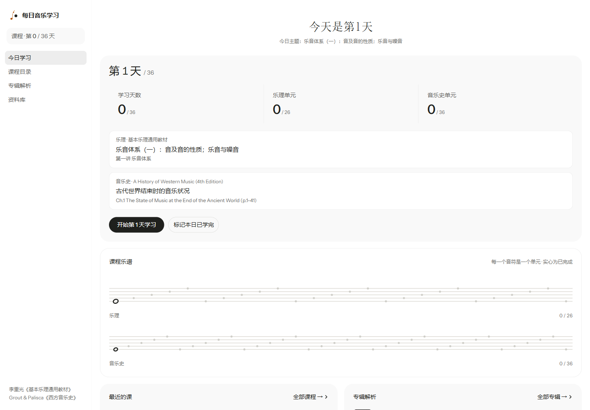
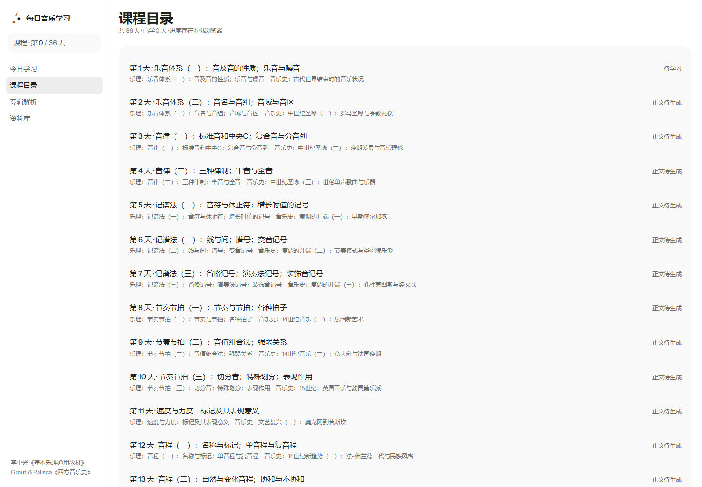
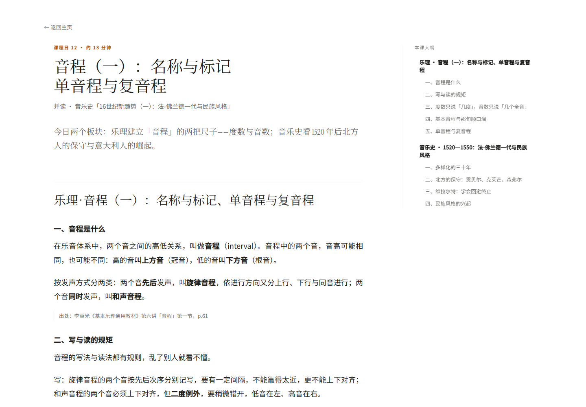
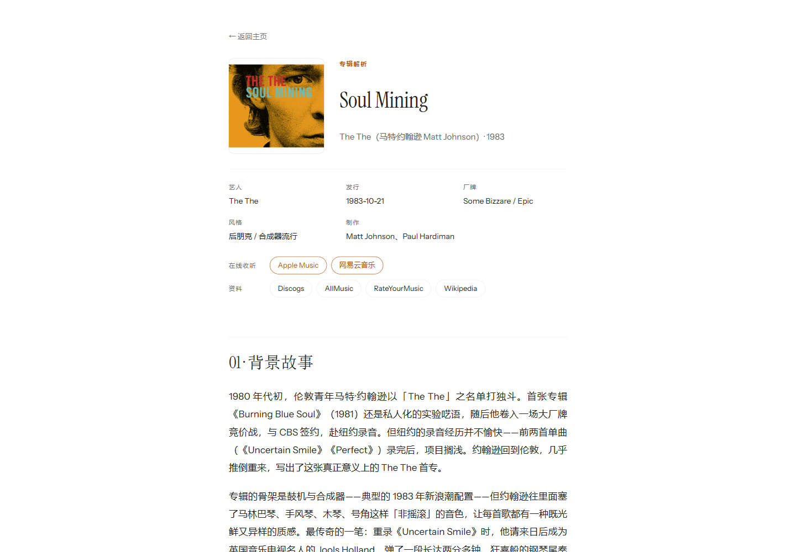
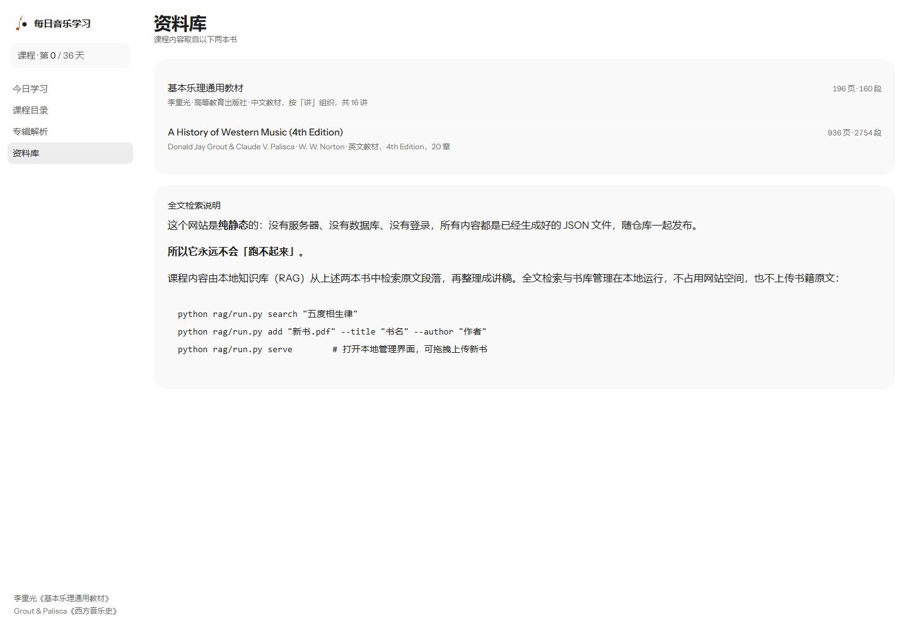
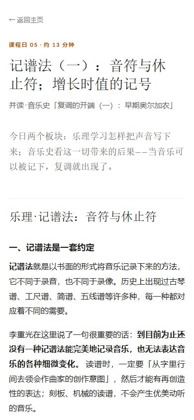
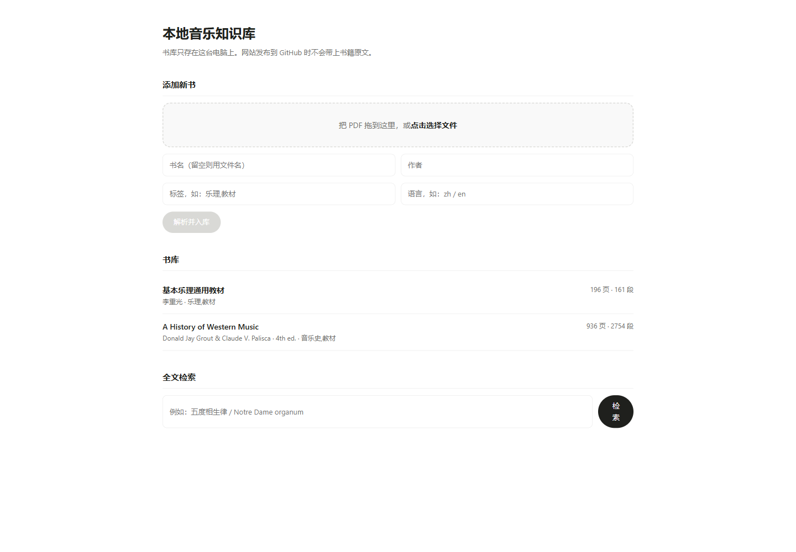

# 每日音乐学习

一个 36 天的音乐自学课程站。每天两个板块：**乐理** 与 **西方音乐史**。

> **线上地址：<https://ryonhhh.github.io/everyday-music/>**

底本是两本经典教材：

| 教材 | 作者 | 承担内容 |
| --- | --- | --- |
| 《基本乐理通用教材》 | 李重光 | 26 个乐理单元（16 讲） |
| *A History of Western Music*, 4th ed. | Donald Jay Grout & Claude V. Palisca | 36 个音乐史单元（20 章） |

## 这是什么

不是一份书单，也不是摘要合集。它把两本书**拆成 36 天的学习路径**，每天把一个乐理单元和一个音乐史单元并置：

- **Day 1–26**：乐理与音乐史双轨并行
- **Day 27–36**：乐理已学完，只走音乐史

每天的课包含正文讲解、今日练习、今日思考、小结，以及可核对到纸质书页码的**原文出处**。

**36 天全部写完**，共约 9.9 万汉字（平均每天 2,700 字上下）。另有 2 篇长篇专辑解析。



## 特点

**讲「为什么」，不是罗列定义。** 例如讲音程转位，会说清为什么协和音程转位后仍协和；讲八调式，会追问为什么中世纪理论要区分终结音与 tenor。

**每处观点可追溯。** 正文里的关键论断都带一行出处，页码是**书上印的页码**，拿纸质书可以直接翻到。

**读完能练、能想。** 每课末尾有练习与思考题，不是读完就完。

**进度存在你自己的浏览器里。** 没有账号、没有服务器、没有登录，打开就能用；进度保存在本机 `localStorage`，不上传任何东西。

## 界面

| 首页 | 课程目录 |
| --- | --- |
|  |  |

读一节课是一页安静的读本：书眉交代场次与时长，衬线标题，36 字一行的正文，「出处」退到边角 —— 需要核对时再去找。

桌面是**双栏**：正文保持舒适行长，右栏常驻本课大纲并高亮当前位置；专辑页右栏换成封面、发行档案与收听链接。窗口收窄到 920px 以下自动并回单栏，大纲变成标题下一行可点的目录。

| 课程正文 | 专辑解析 |
| --- | --- |
|  |  |

专辑页带封面、发行信息，以及可直接点开的**在线收听**与资料链接（Apple Music、网易云音乐、Discogs、AllMusic、RateYourMusic、Wikipedia）。

专辑解析按**长篇评论**的标准写：不是曲目清单，而是用史实把作品撑起来——人物、时间线、几次决裂与和解、逐首拆解关键曲目、最后落到「怎么听」和「为什么它特别」。文中可以插唱片封面（``，渲染为带图注的插页），末尾列出可点开的原始出处。

| 资料库 | 手机端 |
| --- | --- |
|  |  |

本地知识库管理界面（拖拽上传新书 + 全文检索）：



## 用法

- **今日学习** — 显示下一课，点「开始」进入正文；学完标记完成，进度自动推进
- **课程目录** — 36 天全览，显示每天的两个板块与完成状态
- **专辑解析** — 专辑深度解析（背景、乐评、逐曲简析、聆听建议）
- **资料库** — 两本教材的来源与页数，以及本地全文检索的用法

## 本地知识库

课程内容是先从本地书库检索原文段落、再整理成讲稿的。这个知识库跑在本地，**书籍原文不会上传到 GitHub**。

给书库加书（两种方式都行）：

```powershell
# 命令行
python rag/run.py add "新书.pdf" --title "书名" --author "作者"

# 或网页上传：拖拽 PDF 即可
python rag/run.py serve     # 打开 http://127.0.0.1:8765
```

全文检索：

```powershell
python rag/run.py search "五度相生律"
python rag/run.py search "Notre Dame organum" --book Grout
python rag/run.py list
```

中文检索做了专门处理（汉字单字 + 相邻二元组 + BM25），术语像「五度相生律」能被精确命中，不需要额外的分词器。

**加书之后要做什么：** 新书入的是**本地知识库**，不会自动变成网站内容。要写新课程，用 `python tools/unit_context.py <单元编号> --per 2 --digest` 取原文（会自动换算成书上印的页码），照着已有课文的结构写 `data/lessons/day-NN.md`，再跑 `python tools/build_lessons_index.py` 更新目录。

## 创作台（在线生成专辑解析）

打开 **`studio.html`**（侧栏「创作台」）：搜一张唱片 → 填自己的 API Key → 调用云端模型，生成一篇与站内同标准的长文。

- **密钥只存在你的浏览器里。** 请求从浏览器直连服务商（OpenAI / DeepSeek / Kimi / OpenRouter / Anthropic 均可），本站是纯静态页，没有任何服务器能收到它。出门在外别勾「记住密钥」。
- **模型不用背。** 填好 Base URL 与 Key 后点「获取可用模型」，页面会向服务商查 `GET /models`，把这个 Key 能用的模型列出来（对话模型排前、embedding/语音类排后），点输入框即可选；查不到也可以手动填。
- **生成是流式的**，边出字边按站内排版渲染，可随时停止。
- 完成后三个按钮：**下载 .md**、**复制正文**、**复制 index.json 条目**——配合下一节三步就能发布。
- **prompt 可改**：`data/prompts/album-analysis.md` 就是这个生成器的写作规范（结构、事实纪律、禁用词、自检清单），页面每次加载都会读最新版。

## 加一张专辑解析

三步，全在 `data/albums/` 里完成：

**1. 放封面**

```
data/albums/<slug>/cover.jpg
```

**2. 写正文** `data/albums/<slug>.md`

```markdown
> 一句话引言（整篇的钩子）

## 一个人（或：背景）

正文……可以用  插图，
渲染成 320px 的书页式插页，图注就是 alt 文字。

#### 01 · 曲名（谁主唱）
逐曲简析。

## 参考出处

- 来源说明：[链接文字](https://…)
```

约定：`##` 是章节，`####` 是单曲，`>` 出处用单行引用，末尾必须有 `## 参考出处` 且链接可点。

**3. 登记** `data/albums/index.json` 的 `albums` 数组加一条：

```json
{
  "id": "<slug>",
  "title": "专辑名",
  "artist": "艺人",
  "year": "1990",
  "kicker": "专辑解析",
  "byline": "艺人 · 年份",
  "cover": "data/albums/<slug>/cover.jpg",
  "coverAlt": "封面描述",
  "facts": [{ "k": "发行", "v": "1990" }],
  "listen": [{ "platform": "Apple Music", "url": "https://…" }],
  "more": [{ "platform": "Discogs", "url": "https://…" }],
  "summary": "列表页显示的一句话",
  "addedAt": "2026-11-04"
}
```

提交推送，Pages 一两分钟自动重建。右栏的封面、档案、收听链接、列表缩略图都会自动出现，**不用改任何代码**。

## 本地运行

必须用 HTTP 服务器打开，直接双击 HTML 不行（浏览器不允许读取本地 JSON）：

```powershell
python -m http.server 8777 --directory "G:\music everyday"
```

访问 <http://127.0.0.1:8777/>。

## 更新网站

```powershell
git add .
git commit -m "新增第 N 天课程"
git push
```

推送到 `main` 后 GitHub Pages 会自动重建，一两分钟生效。

## 目录结构

```
index.html / detail.html     页面
assets/                      样式与前端逻辑
data/
  curriculum.json            36 天课程表
  lessons/day-NN.md          课程正文
  albums/                    专辑解析
curriculum/plan.json         课程规划（课程结构的唯一来源）
rag/                         本地知识库（书库实体不入库）
tools/                       构建与检索辅助脚本
docs/preview/                README 用截图
```

## 版权说明

书籍原文**不进入仓库**（`.gitignore` 已排除 `*.pdf`、`rag/books/`、`rag/db/`）。
课程正文是对教材内容的讲解与转述，出处以「书名 + 页码」标注，不复制大段原文。教材版权归原作者与出版方所有。

## 维护

技术细节——页码体系换算、PDF 字体重建、引注规范、检索实现——见 [docs/MAINTENANCE.md](docs/MAINTENANCE.md)。
